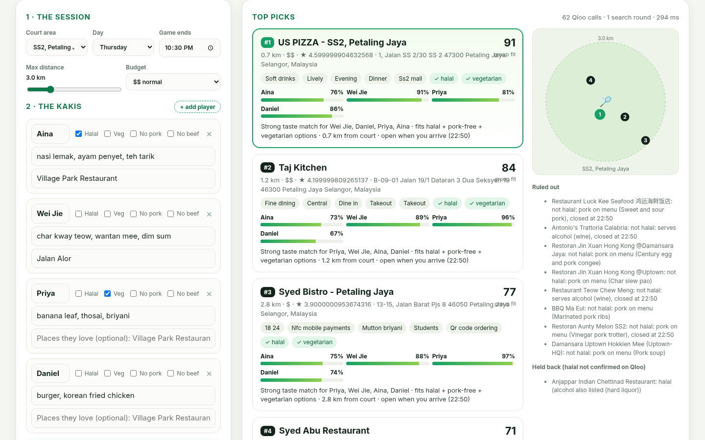

# 🏸 Makan Kaki: the post-game makan agent

> Game over. Where do we makan?

Every badminton group in Malaysia has the same argument at 10:30pm. Aina needs halal, Priya is vegetarian, Wei Jie wants char kway teow, Daniel wants a burger, and everyone is tired. **Makan Kaki** is an agent that settles it. It turns each player's taste into Qloo signals, scores every nearby spot **for every player**, enforces hard rules (halal, no pork, no beef, vegetarian, open when you arrive, budget) against Qloo's own tags and menu data, widens the search if nothing fits, and explains its pick.

Built for the [Qloo Agentic Hackathon](https://qloo.devpost.com/).

**Live demo:** https://makan-kaki-production.up.railway.app (one-click sample run: [https://makan-kaki-production.up.railway.app/?autorun](https://makan-kaki-production.up.railway.app/?autorun)). It runs in **live mode** against the Qloo hackathon API (real Klang Valley and Penang venues). The badge in the header shows "● Live Qloo", and `/api/health` reports `"qloo":"live"`.



## Why Qloo matters here
An LLM on its own can list "popular restaurants near SS2". It can't tell you that the people who love Village Park's nasi lemak *and* the people who love Jalan Alor would both rate a particular Chinese-Muslim noodle house highly. Qloo's taste graph does that. Makan Kaki asks Qloo once per player, so it can find the venue the whole group agrees on (high average, and nobody miserable) rather than the one the loudest player wants.

## How it works (architecture)

```
Browser UI (public/)  ──POST /api/plan──▶  server.js (zero-dependency Node)
                                              │
                                              ▼
                                   src/agent/agent.js  (plan → act → observe → reflect → explain)
                                     │            │                 │
                         src/qloo/index.js     src/agent/scoring.js  src/agent/llm.js (optional)
                         ├─ client.js  (LIVE: hackathon.api.qloo.com)
                         └─ mock.js    (MOCK: fictional venues, same interface)
```

Agent loop:
1. **Plan**: read the session (court, day, game end time → arrival time, radius, budget).
2. **Resolve taste (Qloo tools)**: cravings → `GET /v2/tags` (place tag IDs); liked places → `GET /search` (place entity IDs, near the court).
3. **Group candidates**: `GET /v2/insights` with `filter.type=urn:entity:place`, `filter.location=POINT(lon lat)`, `filter.location.radius`, `signal.interests.tags` + `signal.interests.entities` (all players), `filter.hours=<day>`, `filter.price_level.max`, `feature.explainability=true`.
4. **Per-player scoring**: one more `GET /v2/insights` per player, restricted to the candidate set (`filter.results.entities`), which gives each player's affinity for each venue.
5. **Diet guard** (`src/diet/rules.js`): each venue is checked against Qloo tags and properties (dietary/offerings/genre tag IDs, keywords, description, specialty dishes, name). See [Dietary guard](#dietary-guard) below.
   - For halal groups, the agent also makes an extra Insights pull with `filter.tags` set to Qloo's halal tags, which helps confirmed-halal places reach the shortlist.
   - Opening hours at arrival time are checked too.
6. **Rank**: `0.45·mean + 0.35·min (least misery) + 0.2·proximity + bonus(verified) − penalty(unverified)`. Per-player scoring is chunked to Qloo's `take ≤ 50` limit.
7. **Reflect**: if fewer than 3 spots fit everyone, widen the radius (up to 10 km) and then relax the budget, re-querying each time. Every step is shown in the UI's agent trace.
8. **Explain**: a deterministic template by default. With an LLM key, the LLM writes a one-line pitch **only from the verified facts JSON**, and can parse free-text notes.

## Dietary guard

Qloo's place data is rich but noisy. A place can carry a halal tag *and* list "pork bone soup" or beer. The guard is therefore deliberately conservative, and **negative evidence beats a positive tag**:

| Need | Fails when | Passes when |
|---|---|---|
| **Halal** | pork evidence, "non-halal", a bar/pub/brewery/izakaya, or alcohol tags with no halal tag | Qloo halal tag (`dietary_option:qloo:halal`, `offerings:place:halal_food`, `…halal_options`, `genre:place:restaurant:halal`). Halal-tagged places that also list alcohol stay in but are flagged **"verify"**. |
| **No pork** | pork evidence | halal-tagged, vegetarian-only, or explicitly pork-free |
| **No beef** | beef evidence | vegetarian-only (otherwise "verify") |
| **Vegetarian options** | meat-centric venue (bak kut teh, steakhouse, chicken rice, Korean BBQ…) | vegetarian/vegan tags or wording |

- **Pork evidence** includes a denylist that matches whole words or CJK text in names, tags, keywords and dishes:
  - pork, bak kut teh, char siu/siew, siew yoke, lard, babi, bacon, ham, tonkotsu, lechon…
  - 猪/豬, 肉骨茶, 叉烧, 烧肉, 卤肉…
- **Negations** such as "pork-free", "no pork", "beef bacon", "chicken ham" and "salad bar" are stripped first, so they don't trigger false hits.
- **Unconfirmed halal:** in live mode, a halal group only gets places Qloo tags halal. Places with no pork evidence but no halal tag are **held back** and listed in the UI. They're used only if fewer than 3 confirmed places exist, and then they're labelled "halal? verify".
- Every rejection shows its evidence (e.g. `not halal: pork on menu (Pork ribs noodles)`).

Halal status on Qloo is taste data, not certification. Anything marked "verify" in the UI (and anything strict) should be checked against JAKIM certification.

## Run it

Requires Node 18+. There are no npm dependencies.

```bash
npm start            # http://localhost:8787  (mock mode if no key)
npm test             # 20 unit/integration tests (scoring, diet guard, mock + fake-fetch live client)
```

Open `http://localhost:8787/?autorun` to run the sample group immediately.

### Live Qloo (one env var)
```bash
QLOO_API_KEY=your_hackathon_key npm start
QLOO_API_KEY=your_hackathon_key npm run smoke:live   # checks tags/search/insights against a KL point
```
Hackathon keys only work against `https://hackathon.api.qloo.com` (the default). Override with `QLOO_BASE_URL` if needed. The header used is `X-Api-Key`.

### Optional LLM
```bash
LLM_API_KEY=... LLM_BASE_URL=https://api.openai.com/v1 LLM_MODEL=gpt-4o-mini npm start
```
Any OpenAI-compatible Chat Completions endpoint works. Without it, ranking and explanations are fully deterministic.

### Deploy
Live instance: https://makan-kaki-production.up.railway.app (Railway, `QLOO_MODE=live`). `scripts/build-railway.sh` bundles the server and UI into one gzipped/base64 file (`APP_B64`), which the Railway start command decodes and runs. `Dockerfile` included (`PORT` env respected). It works on any Node/Docker host (Render, Railway, Fly.io, etc.). Set `QLOO_API_KEY` as a secret on the host and never commit it. There is a basic per-IP rate limit (20 plans/min) to protect the API quota.

## Mock mode, honestly
Without `QLOO_API_KEY`, the app uses `src/qloo/mock.js`. It contains **fictional venues** with synthetic affinities around real Malaysian area centroids, and the UI shows a "MOCK DATA" badge. It exists so the UI and agent can be developed and tested without a key. The hosted demo runs in live mode. Set `QLOO_MODE=live` to make a missing key a hard error instead of a silent fallback.

## Data & privacy
Player tastes are sent to Qloo only as tag/entity IDs. Nothing is stored. Qloo responses are cached in memory only (allowed by Qloo for server-side use) and are never written to the repo.

## Built with AI assistance
This project was designed and coded with substantial help from an AI coding assistant, then reviewed and tested by the author. All Qloo integration follows the public hackathon developer guide.

## License
MIT. See [LICENSE](LICENSE).
